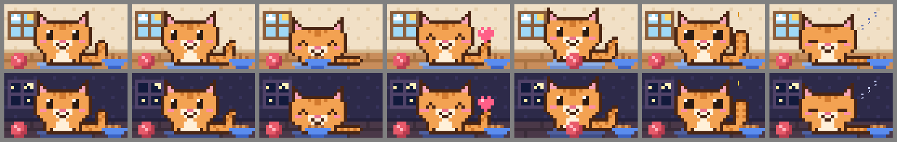
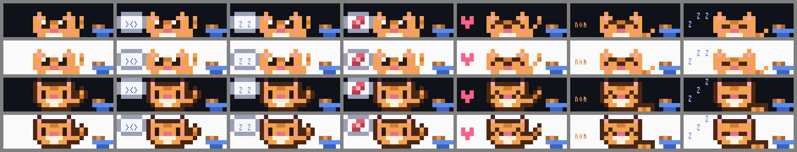
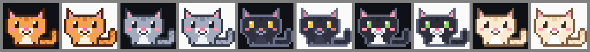

# Claude Cat

A pixel cat for [Claude Code](https://code.claude.com). It sits on the line above your prompt, watches Claude work, and eats the kibble each finished reply drops in its bowl. Open its room to feed it, play, and read its diary.



Unofficial. A community mod, not made by or affiliated with Anthropic.

## What it does

- **On the prompt line.** A pixel cat at the end of the line above your prompt, four rows tall (`/cat small` makes it three, `/cat face` one). Click its name, or the `≡` at the top right, to open the room (clicks need `/tui fullscreen`). A thought bubble shows what it wants (`><>` when hungry, `zZ` when sleepy, yarn when bored), and a tiny bowl shows its kibble.
- **Reacts to your session.** Watches while Claude works, jumps when a tool call fails, and falls asleep after ten quiet minutes. Sending a prompt wakes it.
- **Earns its food.** Each finished Claude reply adds one kibble, up to five.
- **A room.** `/cat` opens it in a side pane: day or night window, stats, Feed, Play, Cuddle and Treat, and a diary.
- **Keeps time.** Its hunger, mood and energy carry over between sessions. A full belly lasts about a day.





## Install

In a Claude Code terminal session:

```
/plugin install pixel-cat --marketplace Exolvion/claude-cat
```

Answer `y` to add the marketplace, then pick a scope.

Needs Claude Code 2.1.287 or later (the mods API) and a terminal with true colour, such as Windows Terminal, iTerm2 or the VS Code terminal. The room docks at the side under the fullscreen renderer (`/tui fullscreen`) when the window is at least 110 columns wide; otherwise it opens above the prompt. The pixel drawings need Claude Code running in a terminal.

## Use

| Type | What happens |
| --- | --- |
| `/cat` | Opens or closes the room. Esc also closes it. |
| `/cat settings` | Size, side, caption and coat. Tab moves, arrows choose, Enter sets. |
| `/cat big`, `/cat left`, `/cat smoke` | Sets one choice straight away. Any choice from the table below works, except `off` (`/cat caption off`). |
| `/cat help` | A short guide. You can also ask Claude about the cat: the plugin ships a guide Claude reads when the cat comes up. |
| `/cat feed`, `play`, `cuddle`, `treat` | Care for it without opening the room. Treats: three a day. |
| `/cat name Biscuit` | Renames it. |
| `/cat hide`, `/cat show` | Takes it off the prompt line, or brings it back. |

In the room, click it (or press `ctrl+x` then `tab`) to use the keys: `f` feed, `p` play, `c` cuddle, `t` treat, `s` settings, `x` close.

## Settings

| Setting | Choices |
| --- | --- |
| Size | Big pixel cat (4 rows, the default), sitting cat (5 or 6 rows, head and body), small pixel cat (3 rows), line art, or a one-line face |
| Side | Right or left |
| Caption | Name and mood, only news such as `+1 kibble`, or off |
| Coat | Tabby, smoke, midnight, tuxedo, cream |

## How it is drawn

Each drawing is a grid of terminal cells. A cell holds the upper half block `▀`: its text colour paints the top pixel and its background paints the bottom one, so one cell is two square pixels. Empty pixels use the terminal's own background. The cat repaints about three times a second, only while it is on screen.

## Development

The plugin id is `pixel-cat`. See [`.claude/CLAUDE.md`](.claude/CLAUDE.md) for the layout, the edit loop and the API quirks, and [`docs/mod-api-notes.md`](docs/mod-api-notes.md) for the parts of the mod API it uses.

```
claude plugin validate .
claude plugin test .
node tools/typecheck.mjs <path to claude-code.d.ts>
node tools/render.mjs
```

## License

[MIT](LICENSE)
